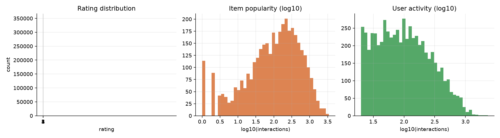
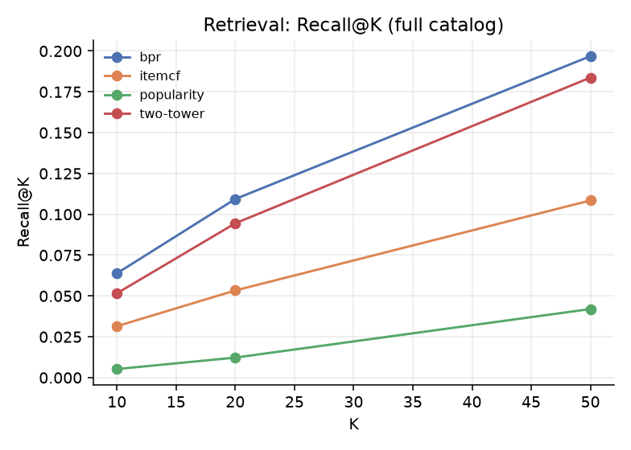
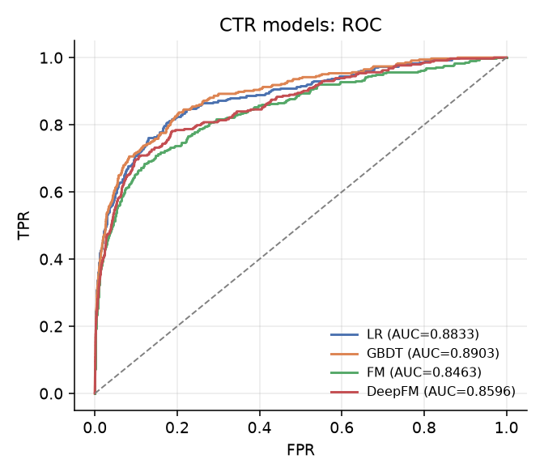
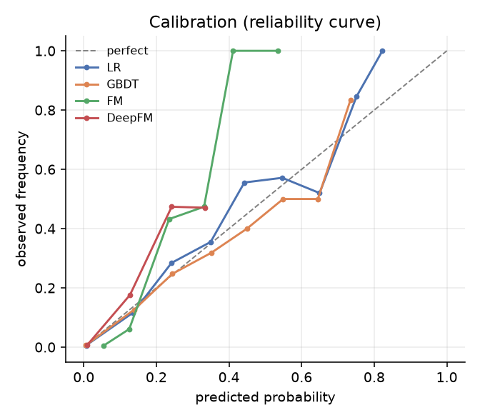
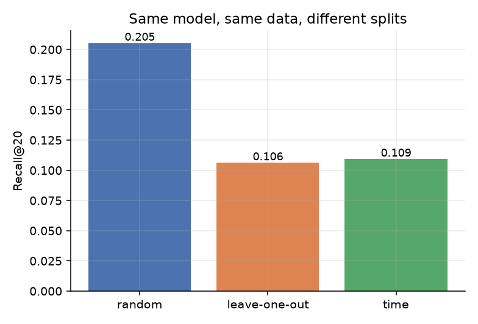
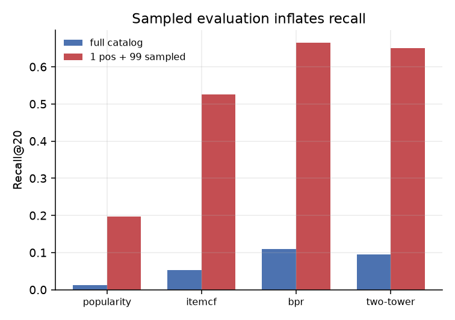
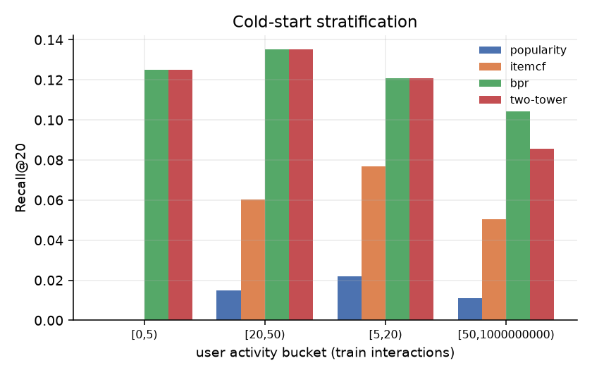
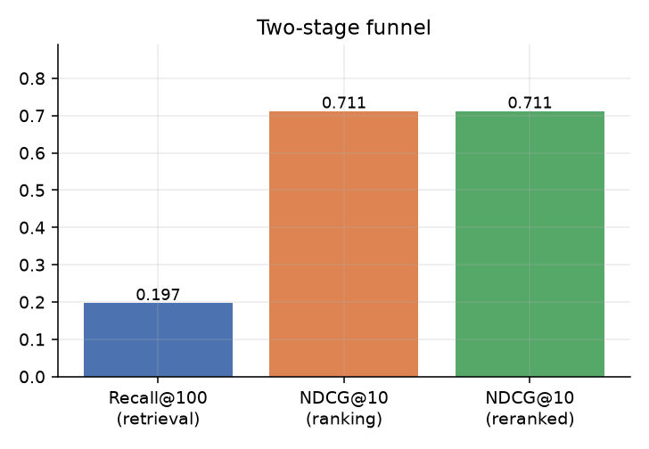

# 两阶段推荐系统实验报告

**数据**：MovieLens-1M（1,000,209 条评分 / 6,040 用户 / 3,706 电影 / 2000-04 ~ 2003-02）
**任务**：给定用户历史，预测他下一次会看什么（next-item prediction）
**环境**：CPU（无 GPU），Python 3.13，PyTorch 2.x
**复现**：`python scripts/run_all.py`，随机种子 20261106，全流程 20 分钟

---

## 摘要

本报告搭建了「召回 → 排序」两阶段推荐链路，对比 4 个召回模型与 4 个排序模型，
并用三组对照实验检验离线指标的可信度。主要结论：

1. **BPR-MF 在准确率上最优**：Recall@20 = 10.94%，是流行度基线的 8.9 倍、ItemCF 的 2.0 倍；
   双塔（9.45%）紧随其后但训练成本高 26 倍。
2. **模型选择取决于约束而非排名**：BPR 准确率最高，双塔曝光结构最健康（Gini 0.639），
   ItemCF 成本最低但多样性最差（Gini 0.801）。
3. **排序阶段模型结构带来的收益 < 1 个 AUC 点**：GBDT 0.8903、LR 0.8833、DeepFM 0.8595、FM 0.8416。
   特征工程（召回分数、流派交叉、热度×活跃度）比换模型更重要。
4. **离线指标高度依赖评估口径**：随机切分比时间切分高 87.7%；1:99 负采样比全库评估高 5.1~16.1 倍，
   且倍数随模型变化。**跨论文/跨简历比较指标前，必须先统一口径。**

---

## 1. 数据

| 指标 | 值 |
|---|---|
| 交互数 | 1,000,209 |
| 用户 / 物品 | 6,040 / 3,706 |
| 稀疏度 | 95.53% |
| 评分均值 / 标准差 | 3.5816 / 1.1171 |
| 用户交互数 P50 / P90 / Max | 96 / 400 / 2,314 |
| 物品交互数 P50 / P90 / Max | 123 / 729 / 3,428 |
| Top 1% 物品曝光占比 | 8.73% |
| 重复 (user, item) 对 | 0 |

长尾明显：Top 1% 的物品占了 8.73% 的交互，而 P50 物品只有 123 条交互。
这个分布决定了后面所有模型在**多样性**上的差异。

---

## 2. 实验设计

### 2.1 切分

| 切分 | 定义 | 用途 |
|---|---|---|
| **时间切分（主实验）** | 前 80% 时间训练，后 20% 时间窗测试，切点 2000-12-02 | 模拟线上：只能用过去预测未来 |
| 留一法 | 每人最后一条作测试 | 学术常用，对照 |
| 随机切分 | 打乱后 80/20 | 复现"虚高"现象，作反例 |

训练集 800,164 条，测试窗 104,543 条。

### 2.2 目标构造（next-item）

测试窗内，每个用户可能有多条交互。若全部作为目标，重度用户（最多 82 条）会主导指标。
因此**每个用户只取窗内最早的一条**作为目标，得到 1,143 个评估用户、每人 1 个目标。
三种切分方式都使用同一协议，保证指标可横向比较。

### 2.3 指标

- **Recall@K / NDCG@K / MRR@K**：K ∈ {10, 20, 50}，主指标 K=20；
- **覆盖率 / Gini / 长尾占比 / 曝光熵**：多样性；
- **AUC / LogLoss / ECE**：排序阶段；
- **候选集 = 全库 3,706 个物品**（已过滤训练期交互），不做负采样。

### 2.4 排序样本

每个评估用户取 1 个真实正例 + 99 个负例（负例从"训练期未交互"中均匀采样），
共 114,200 条，正例率 1.0%。**按用户切分** 70/30（79,900 训练 / 34,300 评估），
避免用户 ID 特征造成泄漏。

---

## 3. 召回层结果

### 3.1 主表

| 模型 | R@10 | R@20 | R@50 | NDCG@20 | 覆盖率@20 | Gini | 长尾占比 | 曝光熵 |
|---|---|---|---|---|---|---|---|---|
| Popularity | 0.52% | 1.22% | 4.20% | 0.0045 | 1.35% | 0.563 | 62.6% | 3.25 |
| ItemCF | 3.15% | 5.34% | 10.85% | 0.0193 | 19.97% | 0.801 | 1.8% | 5.26 |
| **BPR-MF** | **6.39%** | **10.94%** | **19.69%** | **0.0419** | 46.38% | 0.668 | 14.9% | 6.56 |
| Two-Tower | 5.16% | 9.45% | 18.37% | 0.0364 | 52.16% | 0.639 | 17.9% | 6.80 |

### 3.2 讨论

**（1）BPR 为什么赢。**
BPR 用 pairwise 损失直接优化"正例得分 > 负例"，不要求拟合评分。
在只有隐式反馈（是否交互）的场景下，这比回归/分类更贴合目标。
它在 R@20 上比 ItemCF 高 2.05 倍，同时 Gini 更低（0.668 vs 0.801）——
说明它不是靠"多推热门"换来的准确率。

**（2）ItemCF 的多样性陷阱。**
ItemCF 的覆盖率 19.97%，看起来"推得挺广"，但 Gini 0.801 是四个模型里最高的，
长尾占比只有 1.8%。原因：余弦相似度天然聚集在热门物品上，热门物品和谁都像。
**"覆盖率"和"曝光均衡"是两回事**——这是很多分析报告会混淆的地方。

**（3）双塔：成本与收益的取舍。**
双塔最终 R@20 = 9.45%，只比 BPR 低 1.5 个点，但：

| 维度 | BPR | 双塔 |
|---|---|---|
| 训练时间 / epoch | 3.5 s | 93 s（26×） |
| 总训练时间（12 epoch） | 42 s | 18.6 min |
| 覆盖率@20 | 46.38% | **52.16%** |
| Gini | 0.668 | **0.639** |
| 长尾占比 | 14.9% | **17.9%** |
| 新物品上线 | 需重训 | **向量可增量计算** |

结论：**离线准确率选 BPR，长尾生态与可扩展性选双塔。** 这个取舍要在报告里讲清楚，
而不是简单宣布"BPR 更好"。

**（4）双塔的三个实现坑（已修）。**

| 坑 | 现象 | 修法 |
|---|---|---|
| 用户塔/物品塔空间不一致 | R@20 仅 3.2%，比 ItemCF 还差 | 历史聚合用 `item_emb + genre_proj`，与物品塔同空间 |
| in-batch 负例天然偏热门 | 热门物品向量被压小，召回偏低 | 加 logQ 校正：`logits -= log q(j)` |
| 温度可学习 | temp 从 0.07 坍缩到 0.036，softmax 近 one-hot，梯度消失 | 固定 0.07 |

修完三个坑，R@20 从 3.2% → 9.45%。**这条排查链本身就是这个项目最有价值的工程经验。**

---

## 4. 排序层结果

### 4.1 主表

| 模型 | AUC | LogLoss | ECE | Top-10 NDCG |
|---|---|---|---|---|
| LR | 0.8833 | 0.0393 | 0.0012 | — |
| **GBDT** | **0.8903** | 0.0395 | 0.0010 | **0.7115** |
| FM | 0.8416 | 0.0726 | 0.0405 | — |
| DeepFM | 0.8595 | 0.0429 | 0.0022 | — |

### 4.2 讨论

**（1）模型结构带来的收益 < 1 个 AUC 点。**
GBDT 比 LR 只高 0.0070。这说明在本特征集下，**特征工程已经吃掉了大部分信号**：
召回分数、流派亲和度、热度×活跃度这三个交叉特征贡献最大。

**（2）FM 最差的原因。**
FM 的价值在于自动学二阶交叉。但本项目已经手工构造了流派内积（`x_genre_affinity`），
FM 的二阶项没带来新信息；同时稀疏 ID 字段有 6,040 + 3,706 类，参数多、样本少，容易过拟合。
DeepFM 加了 MLP 之后追到 0.8595，但仍不如 GBDT。

**（3）ECE 的陷阱。**
四个模型 ECE 都 < 0.05，看起来"校准完美"。但正例率只有 1%，模型输出集中在 0.01 附近，
**绝对误差天然小**。真实的校准要看可靠性曲线（图 08）：中间几档（预测概率 0.1~0.3）
样本很少，曲线抖动明显。**只看 ECE 会被骗。**

**（4）为什么 Top-10 NDCG 只有 0.7115。**
因为候选集是 100 个里排 10 个，而正例只有 1 个——NDCG 的分母是理想排序（正例在第 1 位），
能到 0.71 说明大部分用户的正例被排进了前 3。

---

## 5. 诊断实验（核心贡献）

### 5.1 切分偏差

同一个 BPR 模型、同样的 next-item 协议、每人 1 个目标，只换切分：

| 切分 | Recall@20 | 评估用户数 | 相对时间切分 |
|---|---|---|---|
| 随机切分 | **20.53%** | 6,035 | **+87.7%** |
| 留一法 | 10.63% | 6,040 | −2.8% |
| **时间切分** | **10.94%** | 1,143 | 基准 |

**机制**：随机切分让模型在训练时见到"未来"的交互。同一用户的相邻评分高度相关
（刚看完 A 觉得好，接着看同类的 B 也给高分），信息从测试集漏进训练集。

**启示**：任何写"随机切分下 Recall 20%"的简历/论文，数字都不可直接采信。

### 5.2 采样偏差

| 模型 | 全库 R@20 | 1:99 采样 R@20 | 虚高倍数 |
|---|---|---|---|
| Popularity | 1.22% | 19.77% | ×16.1 |
| ItemCF | 5.34% | 52.58% | ×9.9 |
| **BPR** | **10.94%** | **66.49%** | **×6.1** |
| Two-Tower | 9.45% | 65.09% | ×6.9 |

**机制**：候选集从 3,706 缩到 100，分母小 37 倍。原本排第 150 的正例，在 100 个候选里可能排进前 20。

**关键观察：虚高倍数不是常数**（6.1 ~ 16.1）。模型越强，虚高越少——
因为强模型本来就不依赖"采样删掉失败案例"。**因此不能用系数换算两种口径的指标。**

### 5.3 冷启动分层

| 训练互动数 | 用户数 | Popularity | ItemCF | BPR | Two-Tower |
|---|---|---|---|---|---|
| [0,5) | 8 | 0.00% | 0.00% | **12.50%** | **12.50%** |
| [5,20) | 91 | 2.20% | 7.69% | **12.09%** | **12.09%** |
| [20,50) | 133 | 1.50% | 6.02% | **13.53%** | **13.53%** |
| [50,∞) | 911 | 1.10% | 5.05% | **10.43%** | 8.56% |

**观察 1**：ItemCF 在最冷的桶（<5 条）掉到 0——没有足够历史算相似度。
**观察 2**：BPR 与双塔在冷用户上完全打平（12.5% / 12.09%），说明隐向量泛化有效。
**观察 3**：双塔在重度用户（≥50）反而掉到 8.56%。原因：它的用户向量是"历史均值"，
重度用户历史太杂，均值被稀释；BPR 的 pairwise 目标对每个正例单独优化，不受此影响。

**这条是"没有免费午餐"的具体证据**：同一个设计（历史均值）在冷用户上是优点，在热用户上是缺点。

---

## 6. 漏斗

| 阶段 | 指标 | 值 |
|---|---|---|
| 召回 BPR@20 | Recall@20 | 10.94% |
| 召回 BPR@50 | Recall@50 | 19.69% |
| 排序 Top-10 | NDCG@10 | 0.7115 |

召回@50 只有 19.69%，意味着**80% 的目标物品根本没进候选集**——这是当前系统最大的瓶颈。
排序层再怎么优化，也无法挽回召回漏掉的 80%。

---

## 7. 局限性

1. **数据规模小**：80 万条交互，不足以让深度模型（双塔、DeepFM）发挥优势。
   结论中的"哪个模型更好"只在同等规模下成立。
2. **只有隐式反馈**：用"是否评分"当交互，把"评分 2 分"和"评分 5 分"同等对待。
   引入评分权重（如 BPR 加权）可能提升。
3. **无真实曝光日志**：CTR 样本是构造的（1 正 99 负），不是真实曝光分布。
   真实场景中"未曝光"和"曝光未点击"要分开建模。
4. **离线评估无线上验证**：所有结论都是离线指标，没有 A/B 实验。
5. **双塔未调优到极限**：12 epoch 明显未收敛，但继续训练成本不可接受（每 epoch 93 秒）。
6. **冷启动桶样本过小**：[0,5) 只有 8 个用户，指标波动大，仅作定性参考。

---

## 8. 结论与后续

**能带走的三个判断：**

1. **评估口径比模型重要。** 同一模型、同一数据，切分方式差 1.9 倍，负采样差 6 倍。
   做推荐系统第一步不是选模型，是定口径。
2. **准确率与多样性是两条线。** BPR 准确率最高，双塔曝光最健康，ItemCF 最便宜但最集中。
   没有"最好"的模型，只有"最合适的取舍"。
3. **特征 > 模型结构。** 排序层四个模型差不到 1 个 AUC 点，而加一个召回分数特征就能补上这个差距。

**后续优先级：**

1. 用 MovieLens-25M 重跑，验证"数据规模决定模型选择"；
2. 加序列模型（SASRec / BERT4Rec），利用时间顺序信息；
3. 把召回@50 从 19.69% 提上去（多路召回融合：BPR + 双塔 + 内容召回）；
4. 用后 20% 时间窗模拟在线 A/B，评估累积收益而非单点 NDCG。

---

*报告中所有数字来自 `reports/results.json` 与 `outputs/tables/*.csv`，可用 `python scripts/run_all.py` 复现。*